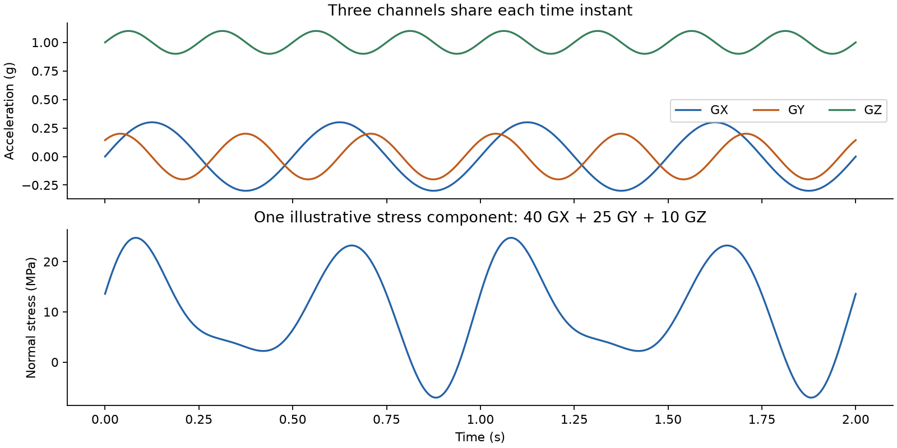
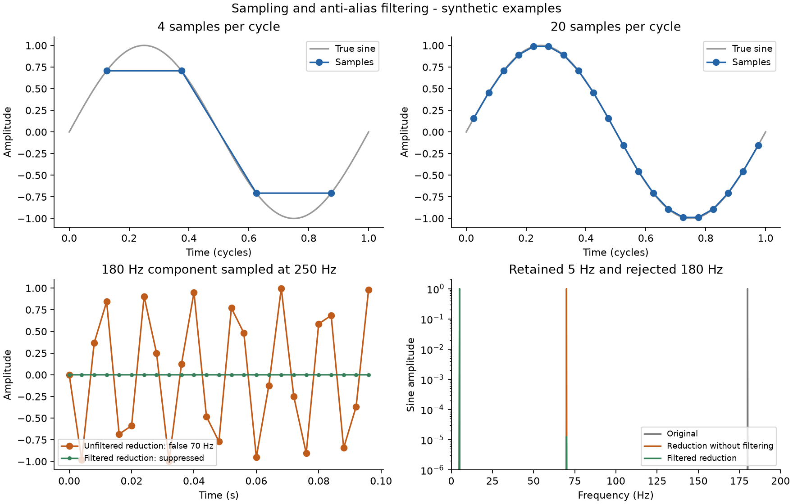

# From vehicle acceleration to fe safe loading

We prepare three signed acceleration histories, preserve their synchronization,
and use them to scale three FE stress datasets. Start with the full-rate recording.
Reduce its sample rate only after establishing the required bandwidth and checking
fatigue results. The final **AMC file** carries the signals to another fe-safe
machine; the recipient also needs the appropriate FE results and fatigue settings.


## What the numbers mean

Each row is one instant. At sample rate $f_s$, samples are separated by
$\Delta t=1/f_s$. At 1000 Hz this is 0.001 s. We check the measured time column,
then export accepted data on a uniform grid starting at zero. The original start
time and maximum timing error remain in `report.json`.

Let $G_X(t)=a_X(t)/g_0$, with $g_0=9.80665\ \mathrm{m/s^2}$, and similarly for Y
and Z. Thus a measurement of 0.4 g becomes a multiplier of 0.4 for a matching
1 g FE reference load. The unit conversion is numerical; naming a channel “g”
does not normalize an incorrectly defined FE load case.

For linear, quasi-static reference responses, fe-safe reconstructs:

$$
\boldsymbol{\sigma}(t)=\boldsymbol{\sigma}_0+
G_X(t)\boldsymbol{\sigma}_{X,1g}+
G_Y(t)\boldsymbol{\sigma}_{Y,1g}+
G_Z(t)\boldsymbol{\sigma}_{Z,1g}.
$$

The stress **tensor** contains the normal and shear components. fe-safe adds these
components, then evaluates fatigue. It does not add von Mises stress magnitudes.
$\boldsymbol{\sigma}_0$ represents any separately defined constant contribution.
Reference datasets must represent incremental loads consistently; a repeated
preload inside each dataset would be scaled incorrectly. [1, §13.1]



*Synthetic example: one normal stress component is $40G_X+25G_Y+10G_Z$ MPa.
These coefficients illustrate the math; they are not component properties.*

The FE load directions, signs, masses and restraints must match the measurement's
physical meaning. Sensor axes may need transformation. An inertial force acts
opposite acceleration, so establish signs using the actual FE load convention.
A dataset generated under 10 g needs a multiplier $G/10$, rather than $G$.

**Quasi-static** means dynamic amplification is negligible in the relevant band.
Three static reference cases do not predict resonance. If the measured excitation
drives structural modes, obtain the stress response through a suitable dynamic
analysis. A local accelerometer response is not automatically a uniform load for
the entire component. [4]

## What preparation changes

The default run checks data and converts units. It preserves sample rate, signed
values, mean load, gravity content and shocks. It does not automatically despike,
subtract the mean, high-pass filter, interpolate missing values or peak-pick.

Check sensor position, calibration, clipping and true impacts. Clipping is a flat
peak at the instrument limit; its lost amplitude cannot be restored by smoothing.
Correct only identified recording faults and keep an untouched original.

Gravity treatment needs particular care. A DC-sensitive accelerometer can measure
gravity, while a processed recorder output may already compensate it. Pitch and
roll change its projection onto all axes. Removing 1 from Z or subtracting the
whole-record average is not a general gravity correction. Include physical gravity
once, consistently with the FE model. [5]

Speed and distance help identify duty and define life in hours or miles; they are
not extra G-load channels. Confirm whether speed is mph, m/s or the unusual
miles/s. Do not multiply the accelerations by speed.

## Why filtering comes before reduction

The **Nyquist frequency** is $f_s/2$. Content above a new Nyquist frequency can
fold into lower frequencies during reduction. This is **aliasing**. For example,
180 Hz sampled at 250 Hz appears at 70 Hz. Filtering after that operation cannot
identify and undo the error. [2, §1.2]

Fatigue also requires accurate peaks. The manual's approximate ten samples per
highest relevant cycle is a practical starting point, not an accuracy guarantee.
For a relevant 20 Hz component, 200–250 samples/s may be worth testing. A relevant
100 Hz component can justify retaining 1000 samples/s. Structural response and
fatigue convergence determine the accepted rate. [2, §1.2]



*Top: four samples per cycle can miss peaks. Bottom: an unfiltered 180 Hz
component aliases to 70 Hz after reduction. Filtering suppresses it first.*

For an explicitly requested integer reduction $q=f_s/f_{out}$, the tool applies
the same symmetric finite impulse response (**FIR**) filter to all channels:

$$y_j[m]=\sum_{k=-K}^{K} h[k]\,G_j[mq-k],\qquad j\in\{X,Y,Z\}.$$

The coefficients have unit sum to preserve constant load. Symmetry and centered
filtering avoid a relative channel delay. A specified **passband** is retained
close to unit amplitude. A **stopband** begins at $f_{out}/2$. The transition
between them is gradual. Default stopband attenuation is at least 80 dB, an
amplitude ratio of $10^{-80/20}=0.0001$. The design's passband error and stopband
gain are checked on a dense frequency grid and recorded. This numerical check
does not establish fatigue equivalence. [6]

At the record boundaries the filter needs values beyond the measured interval.
The tool uses linear extension and reports the affected time at each end. Inspect
those intervals and retain real lead-in/lead-out data where possible. Compare the
prepared history with the full-rate reference at critical and less-critical FE
locations, using consistent fatigue settings. Do not add an unvalidated load-history
gate during this comparison. Multichannel peak-picking is a separate approximation
and is not used here. [1, §13.4]

## Prepare the file

Install Python 3.11–3.14, clone this repository, open its folder in a terminal,
and run `python setup_environment.py` once. On some systems use `python3`.

Use one continuous table with numeric seconds and acceleration columns. Recommended
headers are `time_s`, `accel_x_g`, `accel_y_g`, `accel_z_g`; other columns are allowed.
The included workbook is synthetic and can be used to check the workflow.

```sh
python run.py inspect "input/drive.xlsx"
python run.py prepare "input/drive.xlsx" --out results/full
```

The importer recognizes common labels, title rows and units. Ambiguous layouts
need `--sheet`, `--header-row` or an explicit [mapping](../examples/mapping.json).
Units can be supplied with `--time-unit s --accel-unit g` when they are known.
Unknown or missing data stop the run. Details are in the [README](../README.md).

Only if the required band is established, an illustrative reduction is:

```sh
python run.py prepare "input/drive.xlsx" --target-rate 250 --passband-hz 20 --out results/reduced
```

Inspect `diagnostics.png` for the complete time envelopes and averaged **power
spectral density** (PSD), whose units are $g^2/\mathrm{Hz}$. Inspect `event.png`
around the largest excursion and other relevant operating sections separately.
The largest excursion need not be the most damaging fatigue event, and averaged
spectra can hide brief events. `filter.png` shows the actual filter response.

The output `signal.asc` has the documented header and only three load columns:

```text
SafeTechnologyASCII
1000
Time:Secs
GX	GY	GZ
Acceleration:g	Acceleration:g	Acceleration:g

0.1	-0.2	1.0
```

Lines 4 and 5 are tab-separated; line 6 is blank. The rate changes only when the
samples are actually resampled. The header defines time, so there is no extra
time column to misidentify as a load. [3, §205.2.3]

## Inspect and export in fe safe

These controls follow the 2026 guide. Check equivalent labels in other releases.

1. Open or create a fe-safe project. Select **File → Data Files → Open Data File(s)**
   and open `signal.asc`.
2. Expand it in **Loaded Data Files**. Confirm exactly **GX, GY, GZ**.
3. Select the three channels. Choose **View → Stack Plot(s)**, then **View →
   Numerical Listing**. Check several signed values against the text file.
4. Choose **View → Properties**. Check signal information and the time range against
   `report.json`. The last sample time is $(N-1)/f_s$, not $N/f_s$.
5. Select only GX, GY and GZ. Choose **File → Data Files → Save Data File(s) As**.
   Set **Save Format → Dassault Systemes AMC**, choose `vehicle_xyz.amc`, retain the
   complete range, and set **Reduction Factor = 1**. The script has already done
   any requested reduction.
6. Close and reopen the AMC. Repeat the channel, sample-count, timing and value
   checks. This native round trip is required before releasing a new workflow.
   [1, §§7.5.2–7.5.5, 7.5.10, 7.5.20]

AMC is fe-safe's multichannel binary container. DAC normally stores one channel.
ASCII is portable text and can be used directly; LDF describes how histories and
FE datasets are connected. Converting ASCII to AMC does not change the physics.
[3, §§205.2.1–205.2.3]

## Transfer and define the superposition

Send the validated **`vehicle_xyz.amc`** as the standalone signal file. Keep the
originals and processing report locally. Complete the generated `HANDOFF.md`,
especially sensor location, directions/signs, gravity, reference loads and duty
equivalence. Share this engineering information with the recipient. Record the
final file's hash with `python run.py hash vehicle_xyz.amc`.

The recipient opens the AMC through **File → Data Files → Open Data File(s)**.
With the correct FE stress results already imported:

1. Go to **Fatigue from FEA → Loading Settings** and create/select **one block**.
2. Select the X reference stress dataset in **Current FE Models** and GX in
   **Loaded Data Files**. Choose **Add… → A Load * Dataset**.
3. Repeat for the Y dataset/GY and Z dataset/GZ in the **same block**. Check each
   dataset reference and scale. Separate sequential blocks would change the duty.
4. If needed, double-click **Loading is equivalent to…** and enter the representative
   distance or time. Preserve the original duty equivalence when reducing samples.
5. Save with **File → Loadings → Save Current FEA Loadings As…** to create an LDF.
   It references the signal file; preserve or update that path when moving projects.
6. Complete material and fatigue settings, and validate reduced versus full-rate
   results before adopting the reduced history. [1, §§13.2, 13.8]

One AMC is sufficient to transfer **the signals**. It cannot contain the FE model,
the three stress datasets, material properties or the physical load convention.
Those must be available to the receiving analyst.

## Sources

Original explanations and synthetic figures. Vendor manuals are linked, not
redistributed. The SIMULIA 2026 copies below are served by Virginia Tech.

1. [fe-safe User Guide](https://docs.software.vt.edu/abaqusv2026/English/FesafeUserPdf/FesafeUser.pdf),
   §§7.5, 10.3–10.5, 13.1–13.4 and 13.8–13.9.
2. [Signal Processing Reference](https://docs.software.vt.edu/abaqusv2026/English/FesafeSignalProcPdf/FesafeSignalProc.pdf),
   §§1.2, 2, 4 and 9.
3. [User Guide Appendices](https://docs.software.vt.edu/abaqusv2026/English/FesafeAppendixPdf/FesafeAppendix.pdf#page=21),
   §§205.2.1–205.2.3; ASCII header example on PDF page 22.
4. [Abaqus modal dynamic analysis](https://docs.software.vt.edu/abaqusv2026/English/SIMACAEANLRefMap/simaanl-c-modaldynamic.htm).
5. [Analog Devices AN-1057](https://www.analog.com/en/resources/app-notes/2020/07/22/16/49/an-1057.html),
   gravity projection, motion and sensor calibration.
6. SciPy [resample_poly](https://docs.scipy.org/doc/scipy/reference/generated/scipy.signal.resample_poly.html),
   [kaiserord](https://docs.scipy.org/doc/scipy/reference/generated/scipy.signal.kaiserord.html),
   and [firwin](https://docs.scipy.org/doc/scipy/reference/generated/scipy.signal.firwin.html).
